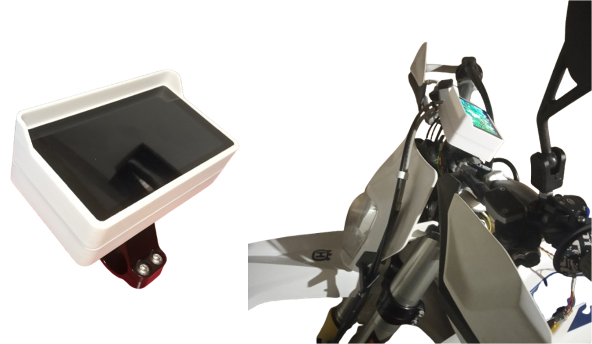
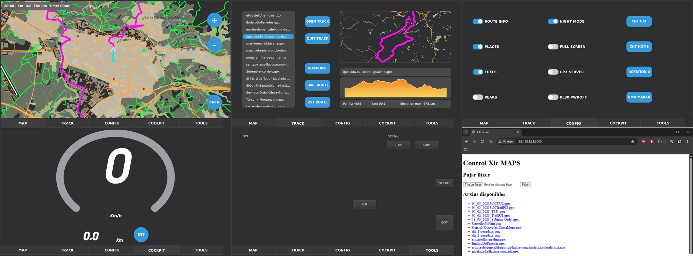

# Control Xic Maps

## Overview

The goal of this research project was to develop a motorcycle-mounted navigation device capable of displaying offline vector maps, recording GPS tracks, and providing navigation capabilities.

## Images

Device    
   
  
  
App Tabs and GPX SERVER web   
  
  
## Project Background

The first prototype was based on an STM32H743 microcontroller paired with a 5-inch display. It used raster map tiles (`tiles.png`), but map rendering and processing performance proved to be too slow.

We then explored switching to vector maps. However, the learning curve and complexity of the available libraries made this approach challenging with the STM32 platform.

Eventually, we decided to move to a microprocessor-based platform — or, to put it simply, the easier option\!

One might ask: why not simply use an Android application, considering that excellent alternatives such as DMD2 already exist?

Well, because this device is fully integrated into the motorcycle — And, most importantly, it’s my pastime!\!

## App Features

- **Offline maps:** The app uses `maps.osm.pbf` files converted into the `MBTiles` format using Tilemaker.
- **Automatic track recording:** When the motorcycle is started, the device automatically begins recording a GPS track. The recorded track can later be saved or discarded, ensuring that no recording is lost unintentionally.
- **Multiple tracks:** Several GPX tracks can be loaded and displayed simultaneously.
- **Map display options:** Various map overlays and display settings are available, including gas stations, town names, mountain peaks, and night mode.
- **GPX Server:** Enabling the **GPX SERVER** switch creates a Wi-Fi access point and makes a web interface available through a local IP address. This allows tracks to be uploaded or downloaded and application updates to be installed.
- **Custom map generation:** Maps can be generated for individual countries or multiple countries combined, using Tilemaker.

## Power Management and Vehicle Integration

The device is fully integrated into the motorcycle's electrical system and uses the **KL30 (permanent battery supply)** and the **ignition switch** to manage its power state.

It is powered directly from the motorcycle's battery and uses a MOSFET-based power management circuit to completely disconnect the device when the motorcycle is stationary, ensuring zero standby power consumption.

Startup and shutdown are therefore fully synchronized with the motorcycle and handled automatically.

The power management logic works as follows:

- **Power-on:** The device starts when power is detected on the KL30 line.
- **Push-button shutdown:** If the device is switched off using the motorbike off-push-button, shutdown is delayed by 5 minutes.
- **Ignition shutdown:** When the ignition is switched off, the device shuts down immediately.

## Hardware

The device is built around an **Orange Pi Zero 2 W(4 GB RAM)**, a compact board offering a good balance between performance and size.

Main hardware components:

- **Main board:** Orange Pi Zero 2 W(4 GB RAM).
- **Display:** Waveshare 5-inch, 1280 × 720 touchscreen.
- **GPS:** Integrated GPS NEO-8M module with an external antenna.
- **Custom PCB:** Designed specifically to integrate and connect all the hardware components.

### Custom PCB Connections

The custom PCB includes a dedicated connector for the motorcycle electrical system and external peripherals.

The connector provides the following signals:

| Signal | Description |
| --- | --- |
| KL30 | Set when Motor i on |
| Key | key switch signal |
| VBAT + GND | Battery power and ground |
| GPS antenna + GND | External GPS antenna connection |
| 5V + GND | Power supply for the handlebar-mounted Bluetooth controller (comming soon)|

## Software

The software is developed using **Qt** and **QGIS libraries**, providing the mapping and navigation functionality.

## Additional Notes

The original hardware design also included an IMU (Inertial Measurement Unit).

The IMU-related code is still present in the project but has been commented out. It was initially intended to support additional features such as:

- ADAS (Advanced Driver Assistance Systems).
- HD Vehicle speed monitoring.
- Motion and sensor data logging.

These features were ultimately dropped and are not part of the current implementation.

Thanks to @qgis for its open-source libraries, as the project would not have been possible without them.
